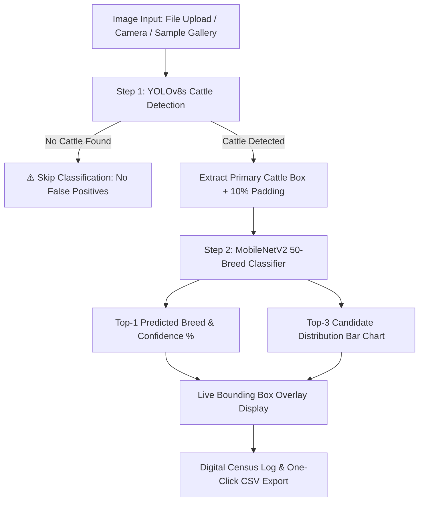

# 🐄 Livestock Breed Identification System

[](https://share.streamlit.io/)
[](https://www.python.org/)
[](https://tensorflow.org/)
[](https://github.com/ultralytics/ultralytics)
[](LICENSE)

An end-to-end Computer Vision system for automated cattle detection and 50-class breed classification. Engineered with a **two-step hybrid pipeline** combining **Ultralytics YOLOv8s** for precise animal localization and **MobileNetV2** for fine-grained breed categorization.

Built and optimized as a native **Streamlit** web application ready for instant one-click deployment on **[Streamlit Community Cloud](https://share.streamlit.io/)**.

---

## 📌 System Architecture



### Why a Two-Stage Pipeline?
Direct classification models often misclassify background objects, humans, or non-target animals as breeds. By placing **YOLOv8s** (COCO Class 19: `cow`) as a gatekeeper:
1. **Zero False Positives on Non-Livestock:** Non-cattle images are identified and rejected before classification.
2. **Background Invariance:** Cluttered farm backgrounds and handlers are removed, feeding only the padded animal patch to MobileNetV2 for maximum classification accuracy.

---

## ✨ Features

- **🌐 Streamlit Cloud Native:** Single-process Python web app requiring no external backend or Node.js server.
- **⚡ Pre-Trained Weights Included:** Ships with `livestock_mobilenetv2.weights.h5` (~16.8 MB) and `yolov8s.pt` (~21.5 MB)—**ready to run out of the box with zero retraining needed**.
- **📷 Multi-Mode Input:**
  - Multi-image drag & drop (`.jpg`, `.jpeg`, `.png`, `.webp`)
  - Live camera capture for field livestock officers using phones or tablets
  - Quick sample gallery for instant 1-click evaluation
- **📊 Top-K Explainability:** View the primary predicted breed along with Top-3 probability rankings.
- **📋 Digital Census Logging:** Automatically logs each analyzed image into an audit table with timestamp and detection latency, downloadable as a `.csv` report.
- **📚 Searchable 50-Breed Directory:** Integrated directory to inspect and search all recognized Indian and exotic cattle breeds.
- **🚀 Memory & CPU Optimized:** Employs `@st.cache_resource` for singleton model caching, staying well within Streamlit Cloud free-tier memory limits (~1GB RAM).

---

## 📖 Documentation Suite

Comprehensive technical guides are available in the **[`docs/`](docs/)** directory:

- 🏛️ **[Architecture & Pipeline Design](docs/ARCHITECTURE.md):** Two-stage CV pipeline, YOLOv8s bounding box padding, MobileNetV2 transfer learning, and state caching.
- 🚀 **[Getting Started & Deployment Guide](docs/GETTING_STARTED.md):** Local installation, CLI scripts (`test_inference.py`, `train_classifier.py`), and Streamlit Cloud setup.
- 🐄 **[Dataset & 50 Cattle Breeds](docs/DATASET_AND_BREEDS.md):** Full 50-breed taxonomic catalog, regional origins, purpose (milch/draught), and class ordering.
- 💻 **[Developer API Reference](docs/API_REFERENCE.md):** Python code documentation for `src/ml_core.py`, custom programmatic pipelines, and CSV schemas.

---

## 📁 Repository Structure

```text
Livestock_Breed_ID/
├── .streamlit/
│   └── config.toml                    # Streamlit theme, UI colors & max upload size
├── data/
│   ├── breeds.json                    # Canonical list of 50 breeds mapped to model weights
│   ├── sample_images/                 # Curated sample images for 1-click testing
│   │   ├── sample_gir.jpg
│   │   ├── sample_sahiwal.jpg
│   │   └── sample_amritmahal.jpg
│   └── cattle/                        # Sample dataset folder (50 breed subfolders)
├── docs/                              # Comprehensive technical documentation
│   ├── README.md                      # Documentation hub & navigation
│   ├── ARCHITECTURE.md                # Two-stage pipeline and system architecture
│   ├── GETTING_STARTED.md             # Setup guide, CLI usage & cloud deployment
│   ├── DATASET_AND_BREEDS.md          # 50 breed directory & dataset traits
│   └── API_REFERENCE.md               # Python API reference & code examples
├── models/
│   ├── yolov8s.pt                     # Pre-trained YOLOv8s cattle detection weights (22.6 MB)
│   └── livestock_mobilenetv2.weights.h5 # Pre-trained MobileNetV2 50-breed weights (17.6 MB)
├── scripts/
│   ├── test_inference.py              # Standalone CLI testing script
│   └── train_classifier.py            # Standalone training script
├── src/
│   ├── __init__.py
│   └── ml_core.py                     # Centralized ML pipeline (YOLOv8, MobileNetV2, preprocessor)
├── app.py                             # Main Streamlit web application
├── requirements.txt                   # Cloud-ready Python dependencies
├── packages.txt                       # System dependencies for Debian/Streamlit Cloud (libgl1, etc.)
├── .gitignore                         # Production gitignore (ignoring caches, envs)
└── README.md                          # Main landing documentation
```

---

## 🚀 Deployment to Streamlit Community Cloud (share.streamlit.io)

Follow these simple steps to deploy this repository for free on Streamlit Cloud:

### Step 1: Push Repository to GitHub
Make sure your project is committed and pushed to your GitHub account:
```bash
git init
git add .
git commit -m "Deploy Livestock Breed ID to Streamlit Cloud"
git branch -M main
git remote add origin https://github.com/<YOUR_USERNAME>/<YOUR_REPOSITORY>.git
git push -u origin main
```

### Step 2: Connect to Streamlit Community Cloud
1. Go to **[https://share.streamlit.io/](https://share.streamlit.io/)** and sign in with your GitHub account.
2. Click **"Create app"** or **"New app"**.
3. Select your repository: `<YOUR_USERNAME>/<YOUR_REPOSITORY>`.
4. Set the **Branch** to: `main`.
5. Set the **Main file path** to: `app.py`.
6. (Optional) Under **Advanced settings**, ensure Python version is set to `3.10` or `3.11`.
7. Click **"Deploy!"**.

Streamlit Cloud will automatically detect `packages.txt` and `requirements.txt`, install all dependencies, cache the models, and launch your live public web app!

---

## 💻 Local Installation & Setup

If you wish to run the application locally on your computer:

### 1. Clone the Repository
```bash
git clone https://github.com/<YOUR_USERNAME>/Livestock_Breed_ID.git
cd Livestock_Breed_ID
```

### 2. Create & Activate a Virtual Environment
```bash
# Windows
python -m venv venv
venv\Scripts\activate

# macOS / Linux
python3 -m venv venv
source venv/bin/activate
```

### 3. Install Dependencies
```bash
pip install -r requirements.txt
```

### 4. Run the Streamlit Application
```bash
streamlit run app.py
```
Open your browser and navigate to `http://localhost:8501`.

---

## 🧪 CLI Testing Tools

### One-Shot Inference via Terminal
To test an image quickly without launching the browser UI:
```bash
python scripts/test_inference.py
```
Enter the image file path when prompted, and the script will output the YOLO detection status, cropped box, detected breed, and confidence percentage.

### Model Retraining (Optional)
The pre-trained weights are already included in the `models/` folder. If you wish to retrain or fine-tune the model on new data:
```bash
python scripts/train_classifier.py
```

---

## 🐄 Supported Cattle Breeds (50)

The model is trained to recognize 50 indigenous Indian and international cattle breeds:

| # | Breed Name | # | Breed Name | # | Breed Name | # | Breed Name | # | Breed Name |
|---|------------|---|------------|---|------------|---|------------|---|------------|
| 1 | Amritmahal | 11 | Kankrej | 21 | Mewati | 31 | Red_Sindhi | 41 | dagri |
| 2 | Ayrshire | 12 | Kenkatha | 22 | Nari | 32 | Sahiwal | 42 | gangatari |
| 3 | Bargur | 13 | Khariar | 23 | Nimari | 33 | Shweta Kapila | 43 | gaolao |
| 4 | Dangi | 14 | Khillari | 24 | Ongole | 34 | Tharparkar | 44 | ghumsari |
| 5 | Deoni | 15 | Konkan Kapila | 25 | Poda Thirupu | 35 | Umblachery | 45 | kherigarh |
| 6 | Gir | 16 | Kosali | 26 | Pulikulam | 36 | Vechur | 46 | malvi |
| 7 | Hallikar | 17 | Krishna_Valley | 27 | Punganur | 37 | bachaur | 47 | motu |
| 8 | Hariana | 18 | Ladakhi | 28 | Purnea | 38 | badri | 48 | nagori |
| 9 | Himachali Pahari | 19 | Lakhimi | 29 | Rathi | 39 | bhelai | 49 | ponwar |
| 10 | Kangayam | 20 | Malnad_gidda | 30 | Red kandhari | 40 | siri | 50 | thutho |

---

## 🛠️ Tech Stack

- **Frontend & App Serving:** [Streamlit](https://streamlit.io/)
- **Object Detection:** [Ultralytics YOLOv8s](https://github.com/ultralytics/ultralytics)
- **Deep Learning / Classification:** [TensorFlow](https://tensorflow.org/) & [Keras MobileNetV2](https://keras.io/api/applications/mobilenet/)
- **Image Processing:** OpenCV (`opencv-python-headless`), Pillow (`PIL`), NumPy
- **Data Export:** Pandas

---

## 📜 Dataset & Acknowledgments

- **Dataset:** [Indian Cattle Image Dataset on Kaggle](https://www.kaggle.com/datasets/atharvadarpude/indian-cattle-image-dataset)
- **Object Detection Pre-training:** YOLOv8 pre-trained on Microsoft COCO dataset.
