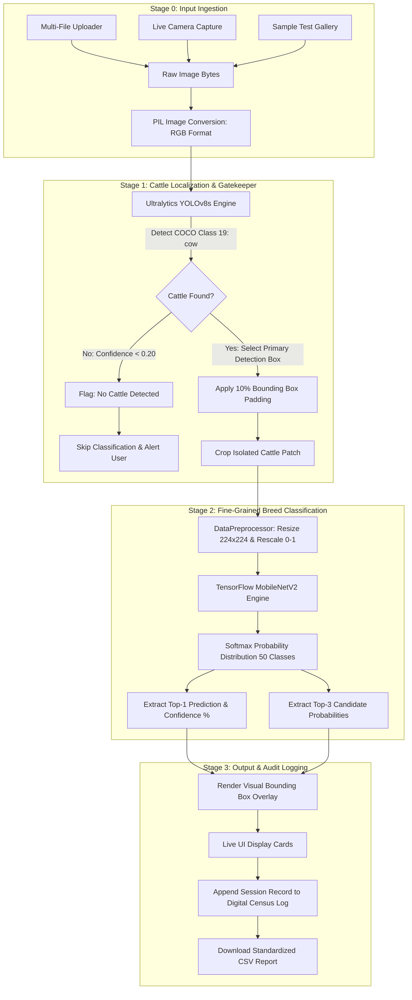
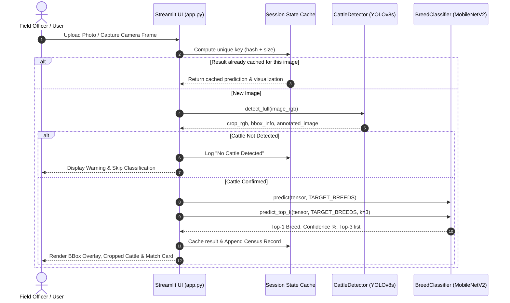

# 🏗️ Architecture & System Design

This document details the software architecture, machine learning pipeline, state management, and algorithmic design choices powering the **Livestock Breed Identification System**.

---

## 1. High-Level System Architecture

The application adopts a **two-stage decoupled pipeline** separating spatial animal detection from fine-grained taxonomic breed classification:



---

## 2. The Two-Stage Machine Learning Pipeline

### Stage 1: Cattle Localization (Ultralytics YOLOv8s)
- **Model:** `yolov8s.pt` (Small variant, ~22.6 MB).
- **Target COCO Class:** Class ID `19` (`cow`).
- **Detection Sensitivity (`conf=0.20`):** Tuned to detect partially visible animals or cattle standing in distant pastures without triggering false detections on background structures.
- **Multi-Animal Area Selection:** When multiple cattle appear in a single photograph, the detector computes bounding box area `(x2 - x1) * (y2 - y1)` and selects the primary (largest / foreground) animal for classification.
- **Dynamic 10% Padding:**
  $$\text{pad}_w = \lfloor (x_2 - x_1) \times 0.10 \rfloor, \quad \text{pad}_h = \lfloor (y_2 - y_1) \times 0.10 \rfloor$$
  $$x_{1,\text{pad}} = \max(0, x_1 - \text{pad}_w), \quad x_{2,\text{pad}} = \min(W, x_2 + \text{pad}_w)$$
  $$y_{1,\text{pad}} = \max(0, y_1 - \text{pad}_h), \quad y_{2,\text{pad}} = \min(H, y_2 + \text{pad}_h)$$
  *Rationale:* Standard object detector boxes tightly clip ears, dewlaps, humps, or hooves. Hump prominence and dewlap skin folds are essential morphological markers for identifying indigenous Indian zebu breeds (*Bos indicus*). Adding 10% context ensures whole-body anatomical visibility.

### Stage 2: Breed Classification (MobileNetV2 Transfer Learning)
- **Base Network:** MobileNetV2 pre-trained on ImageNet.
  - Efficient depthwise separable convolutions yielding high feature extraction accuracy with minimal parameter count (~3.5M parameters, ~14MB memory footprint).
- **Custom Classification Head:**
  ```text
  Input Tensor: (1, 224, 224, 3)
    └── MobileNetV2 Backbone (Feature Extractor: 7x7x1280)
          └── GlobalAveragePooling2D() -> (1, 1280)
                └── Dense(512, activation='relu') -> (1, 512)
                      └── Dense(50, activation='softmax') -> (1, 50)
  ```
- **Inference Preprocessing:**
  - Resized via OpenCV bilinear interpolation to $(224, 224)$.
  - Normalized from $[0, 255]$ integer pixels to $[0.0, 1.0]$ float32 tensor via elementwise division by $255.0$.

---

## 3. Inference Sequence Diagram

The interaction sequence between user interface events, detection, classification, and session persistence:



---

## 4. State Management & Streamlit Cloud Optimization

Deploying to **Streamlit Community Cloud (`share.streamlit.io`)** imposes two technical constraints:
1. **Memory Budget:** Free-tier Linux containers operate under a ~1GB RAM threshold.
2. **Execution Model:** Streamlit re-runs scripts from top to bottom on every user interaction (clicks, text input, tab switches).

### Optimizations Implemented:

#### 1. In-Memory Singleton Caching (`@st.cache_resource`)
```python
@st.cache_resource(show_spinner="Loading models...")
def load_ml_pipeline():
    detector = CattleDetector()
    classifier = BreedClassifier(num_classes=50)
    ...
    return detector, classifier, preprocessor, breeds
```
- Prevents loading multiple duplicate instances of PyTorch and TensorFlow graphs into RAM across sessions.
- Pre-warms weights once during initial container boot.

#### 2. Unique Image Hashing & Caching
To prevent re-running inference on every keystroke or tab switch:
- Each image receives an identification key:
  - File Uploads: `upload_{filename}_{size}`
  - Camera Captures: `cam_{md5_hash(bytes)}`
  - Sample Gallery: `sample_{filename}`
- Results are stored in `st.session_state["processed_cache"]`. On rerun, results render instantaneously without CPU inference overhead.

#### 3. State-Safe Component Reset
- The file uploader and camera input are bound to dynamic version keys:
  - `st.file_uploader(..., key=f"uploader_{st.session_state['uploader_key']}")`
  - `st.camera_input(..., key=f"camera_{st.session_state['camera_key']}")`
- When the user clicks **"🔄 Clear & Reset All"**, the application increments both keys, freeing the uploaded file and browser camera frame from memory while emptying `census_log`.

---

## 5. Deployment & Runtime Specifications

| Dimension | Specification | Details |
| :--- | :--- | :--- |
| **Application Process** | Single Python process | `streamlit run app.py` serving both UI and in-memory inference |
| **Cloud Target** | Streamlit Community Cloud | Native deployment from GitHub via `share.streamlit.io` |
| **Model Storage** | `models/` directory | `yolov8s.pt` (22.6 MB) and `livestock_mobilenetv2.weights.h5` (17.6 MB) |
| **Inference Mode** | CPU-Optimized | Vectorized NumPy / TensorFlow execution (`CUDA_VISIBLE_DEVICES = -1`) |
| **Explainability** | Top-1 + Top-3 distribution | Primary match with confidence badge + candidate probabilities |
| **Audit Logging** | In-Memory Session Log | Interactive tabular view with standardized CSV export |
